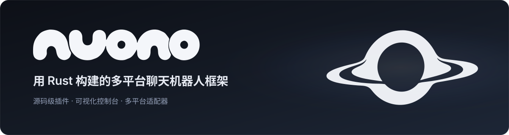

<p align="center">
  
</p>

<p align="center">
  <strong>专注业务逻辑，接入、调度与运维交给框架。</strong>
</p>

<p align="center">
  <a href="LICENSE"></a>
  
  
</p>

---

**Nuono** 是一个用 Rust + Leptos 全栈编写的机器人框架。它提供统一的事件与消息接口、按需组合的源码插件与平台适配器，并内置可视化 Web 控制台。

## 核心特性

- **源码级插件与适配器**：业务插件（`nuono-plugin`）与平台适配器（`nuono-adapter`）均为普通 Rust 库，与宿主统一编译链接，类型安全、无动态库或跨进程协议开销。
- **内置 Web 控制台**：开箱自带管理面板与本地对话沙箱，未接入聊天平台也可调试指令、修改配置、查看日志与管理定时任务。

## 快速开始

环境要求：**Rust 1.100.0+**

```bash
git clone https://github.com/xinxiuzhu/nuono.git
cd nuono
cargo run --release
```

启动后需要马上打开浏览器访问 **http://127.0.0.1:9923**，完成管理员初始化，以免被人抢先注册。

```bash
# 创建新插件或适配器脚手架
cargo plugin new my-plugin
cargo adapter new my-adapter

# 导出包含当前已安装扩展的独立可执行程序（注意这不是交叉编译，所以导出的二进制只能是同样的系统架构才能运行）
cargo run --release -- build --output dist/nuono
```

## 文档导航

- [插件开发指南](docs/plugins/README.md) — 指令、监听、配置表单、存储与测试工具
- [扩展目录与投稿](registry/README.md) — 通过本仓库 Issue 提交 GitHub 插件或适配器
- [参与贡献](CONTRIBUTING.md) — 代码结构、测试规范与提交流程
- [安全策略](SECURITY.md) — 漏洞反馈方式与安全边界说明

## 交流社区

- **QQ 交流群**：`453610195`
- **问题与建议**：欢迎通过 [GitHub Issues](https://github.com/xinxiuzhu/nuono/issues) 反馈

## 许可证

本项目基于 [GNU General Public License v3.0](LICENSE) 开源。
